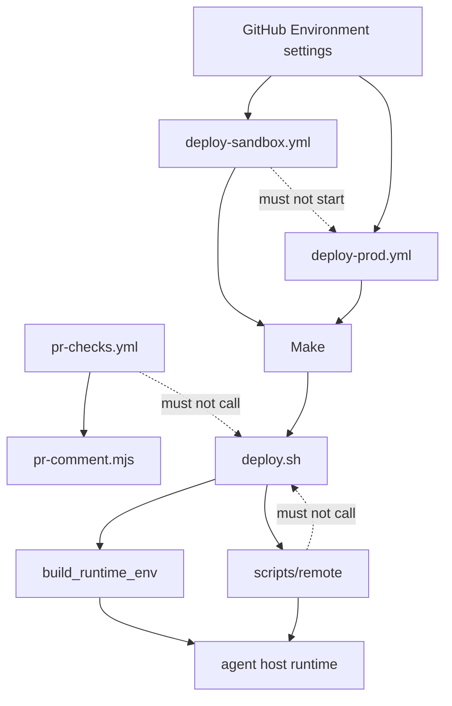
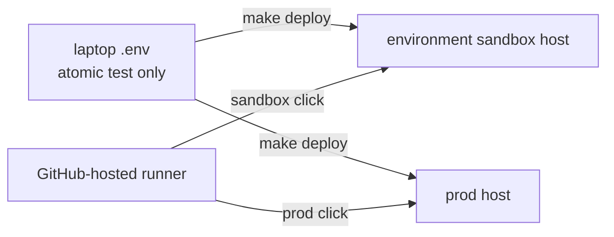

# Architecture Spine — Hermes control plane

## Design Paradigm

Push-model configuration management. One push overlays one git ref and one environment's secret set onto one agent host. It does not delete host files the ref no longer contains. `scripts/deploy.sh` is the push for install, config, upgrade, extensions, and both clicks. It SSHes to one agent host and runs idempotent scripts under `scripts/remote/`. The control plane never becomes the runtime. CD selects the ref and the secret set. It does not add a second push.

## Invariants & Rules



### AD-1 — Single mutator [ADOPTED]

- **Binds:** FR-1, FR-4, FR-18, FR-24, FR-25
- **Prevents:** a CD workflow or extension that SSHes its own bootstrap, secret filter, or session-path patch, or that folds skill and cron sync into `deploy.sh`
- **Rule:** Install, config, upgrade, extension setup, and both CD clicks go through `scripts/deploy.sh`. New entry points of that kind are Make targets that call it. Skill push, skill pull, cron push, and cron pull stay separate commands. Do not fold them into `deploy.sh`. CD clicks do not call them. `pr-checks.yml` does not call `deploy.sh`. Remote scripts do not call back into the control plane. Full deploy order is bootstrap, then Firecrawl unless skipped, then Mnemosyne unless skipped, then Agent-Reach unless skipped, then Notion only when both variables are set, then health, then snapshot when all four AWS and S3 variables are set. A new extension step is appended after Notion and before health. An extension setup failure warns and does not fail the deploy. Health failure fails the deploy. Snapshot failure warns and does not fail the deploy.

### AD-2 — Scripts stay environment-blind

- **Binds:** FR-3, FR-24, FR-25
- **Prevents:** `TARGET_HOST_PROD`, a second env schema, `config.prod.yaml`, or `deploy.sh` branching on an environment name
- **Rule:** Scripts read one unprefixed contract from `$ROOT/.env`. They do not branch on `prod` or `sandbox`. One `config/config.yaml.example` serves both hosts. Per-host differences are values in that host's secret set, not a second config file.

### AD-3 — One secret set per run

- **Binds:** FR-3, FR-24, FR-25
- **Prevents:** a job that holds both secret sets, a host input, an environment-name input, or a workflow-hardcoded snapshot prefix
- **Rule:** The runner writes one mode-600 `$ROOT/.env` from exactly one GitHub Environment, then runs `make deploy`. The workflow lists every name in `.env.sample` that `deploy.sh` or `build_runtime_env` reads, under the same name. A name is omitted only when that Environment secret is unset. It is not a required-only subset. `ALLOW_LOCAL_TARGET` and `PIN_CRON_FORCE` stay unset even if stored. The only rename is `SSH_PRIVATE_KEY`, written to a temp file and passed as `SSH_IDENTITY_FILE`. No host input. No environment-name input. Before `make deploy`, unset the ambient runner `GITHUB_TOKEN` unless that name is a secret in the one Environment in use. Do not forward the runner token. The laptop path still reads a hand-written `$ROOT/.env`. CD does not read it.

### AD-4 — Gates live in repository settings

- **Binds:** FR-25
- **Prevents:** a feature-branch workflow file acting as the security boundary
- **Rule:** GitHub Environments `prod` and `sandbox` both restrict deployment branches to `master`. That setting is in repository settings, not in the workflow file. Each deploy job hardcodes `environment` to one of those names. A run whose ref is not `refs/heads/master` receives neither secret set. A sandbox job must not start a prod job. Do not add a required reviewer. Do not enable prevent-self-review. Do not add a per-workflow actor allowlist.

### AD-5 — What each click checks out

- **Binds:** FR-21, FR-24, FR-25, UJ-4, UJ-5
- **Prevents:** prod running a pull-request SHA, sandbox deploying the wrong revision, or a pull-request branch's own workflow file obtaining secrets
- **Rule:** Both clicks are `workflow_dispatch` of the workflow file on `master`. Workflow files are `.github/workflows/deploy-sandbox.yml` and `.github/workflows/deploy-prod.yml`. Sandbox permissions are `contents: read`, `pull-requests: read`, and `actions: read`. Prod permissions are `contents: read`. Sandbox input is a pull-request number. The master workflow resolves that pull request's head SHA and requires a same-repo pull request. Success means the latest run of `.github/workflows/pr-checks.yml` whose head SHA is that SHA has conclusion success. An older green run does not count. A missing run is not success. The comment line is not this predicate. Do not change `pr-checks.yml` to checkout the head SHA instead of the merge ref as part of the CD work. That job may have tested the merge ref. That gap is accepted. The click then checks that SHA out as the workspace root `make deploy` runs in, and runs that tree's `scripts/deploy.sh`. Do not checkout the candidate to a side directory. Prod has no SHA input and checks out `master` as that same workspace root. No `workflow_run`, `pull_request`, or `pull_request_target` deploy. A green check does not queue a job. A merge does not queue a job. The signal that the sandbox click is available is one line added to the comment `scripts/ci/pr-comment.mjs` already posts, not a second commenter. That line names that checks passed, that the click is the master workflow, and the pull-request number. The first pull request that adds these workflows cannot sandbox-deploy itself. It is tested from the laptop, then merged.

### AD-6 — Same command, prod preflight outside the mutator

- **Binds:** FR-18, FR-24, FR-25
- **Prevents:** a prod click calling `make update` or `--config-only`, `deploy.sh` learning environment names, or a prod click bootstrapping an empty host
- **Rule:** Both clicks run `make deploy` and nothing else. They do not call `skills-push`, `cron-push`, or seed push. Before `make deploy`, the prod workflow SSHes as `TARGET_USER` from the materialised env, with `SSH_IDENTITY_FILE`, `SSH_PORT` defaulting to 22, and the AD-16 options. It does not call `make ssh`. It refuses unless remote `test -x` succeeds for `/usr/local/lib/hermes-agent/venv/bin/hermes` or for `~/.hermes/hermes-agent/venv/bin/hermes` expanded by that remote account. The sandbox workflow does not run this preflight. The preflight is not inside `deploy.sh`. First prod stand-up stays the laptop exception.

### AD-7 — No destroy and no provisioner [ADOPTED]

- **Binds:** FR-24
- **Prevents:** a destroy-prod target, a VPS provisioner, or a required wipe command for the environment sandbox
- **Rule:** This repo does not create, destroy, or resize agent hosts. Wiping the environment sandbox is an operator action outside the repo. The next sandbox click bootstraps whatever host the sandbox secrets point at. Prod has no destroy path.

### AD-8 — One runtime-env writer [ADOPTED]

- **Binds:** FR-3, FR-5, FR-14
- **Prevents:** an extension or CD step that copies the operator env onto the host, or that writes Discord or Notion variables when the pair is half set
- **Rule:** `build_runtime_env` is the only writer of the runtime env. The file mode is 600. It never forwards `TARGET_*`, `SSH_*`, `SKIP_*`, `REMOTE_DIR`, `ALLOW_LOCAL_TARGET`, `PIN_CRON_FORCE`, `FIRECRAWL_MODE`, or `LLM_MODEL`. Discord and Notion are all-or-nothing. A new runtime variable is added there, documented in `docs/03-configuration.md`, and placeholdered in `.env.sample`. A new control-plane-only variable is added to the never-forwarded list and to `tests/test_runtime_env.py`.

### AD-9 — The control plane is never the target [ADOPTED]

- **Binds:** FR-1, FR-24
- **Prevents:** the laptop or the CD runner becoming `TARGET_HOST`, or a story that installs Hermes on the runner
- **Rule:** `refuse_local_target` runs before SSH on every `deploy.sh` mode. It refuses `localhost`, `127.0.0.1`, and `::1` unless `ALLOW_LOCAL_TARGET` is exactly `1`. Any other value, including `true`, still refuses. That override is unset in both GitHub Environments and is not a published sample setting. The click does not call `ssh`, skill sync, or cron sync. Those targets lack the guard today. Leave that gap unchanged until Open Question 5 is decided.

### AD-10 — Session-path patch survival [ADOPTED]

- **Binds:** FR-12, FR-18, FR-19
- **Prevents:** a CD or update path that calls bare `hermes update`, or a health path that uploads a new patch
- **Rule:** Bootstrap, config push, and control-plane upgrade reapply `scripts/remote/patch-hermes-docker.sh`. Config push and control-plane upgrade restart the gateway. Bootstrap and each extension up script also restart the gateway after their own writes. A new extension up script does the same. Do not add a second end-of-deploy restart. The relink target is the first of the two AD-6 venv paths that exists, in the order AD-6 writes them. Config push and bootstrap use that order. Health may keep its existing fallback to `/usr/local/bin/hermes` only when neither venv path exists. That fallback is not a venv binary and is not a prod-preflight path. Health reapplies the patch only when the marker is missing, from the copy already on the host, and does not upload a payload. Bare `hermes update` and `hermes doctor --fix` are not repair paths. Control-plane upgrade refreshes Mnemosyne, Agent-Reach, or Notion only when that piece is already present. It does not install a piece that was never set up. The control plane cannot stop an SSH session that runs bare `hermes update` anyway.

### AD-11 — Loopback extract and a closed forward list [ADOPTED]

- **Binds:** FR-10, FR-12, FR-13
- **Prevents:** publishing search or extract off loopback, adding `AWS_*` to the sandbox forward list, or making Firecrawl full the default
- **Rule:** SearXNG and Firecrawl bind to `127.0.0.1`. `FIRECRAWL_MODE` is passed on the SSH command that runs `firecrawl-up.sh`, from the operator env, default `lite` when unset or empty. `full` is a legal explicit opt-in. It is never written into the runtime env. A cloud extract key may be forwarded if set. It does not replace the loopback bind. On a full deploy the default sandbox image is `hermes-terminal:agent-reach` unless that extension is skipped. That is the only Agent-Reach image tag. `GITHUB_TOKEN` may be forwarded into the sandbox when it is set in the operator env. The ambient runner token is not that value. Cookie-based platform logins are not required for a successful deploy. `terminal.docker_forward_env` does not include `AWS_*`. Widening that list requires a skill that needs the variable inside the sandbox.

### AD-12 — One gateway, deny-by-default [ADOPTED]

- **Binds:** FR-7, FR-8, FR-9
- **Prevents:** a second gateway process, webhook mode as the default, or allow-all in a published default
- **Rule:** Telegram and optional Discord run in one `hermes-gateway` user service with linger. Sessions do not merge. Default transport is long-poll. Webhook mode is not configured. No inbound port. Deploy, config push, seed push, update, and health refuse to start if the Telegram token or allowlist is missing from the operator env. The allowlist is numeric. The control plane forwards it and does not evaluate it. An empty string counts as unset for the Discord and Notion pairs. Discord portal intents are an operator precondition. The control plane does not click through the portal. Health reports Discord only when both values are already in the runtime env. Published defaults do not set allow-all true. The filter copies an explicit true. Do not add a refuse-true check until Open Question 1 is decided. A home channel is optional, forwarded only when set, and has no control-plane default. One per platform. They do not cross-post.

### AD-13 — Registration is the case and the Make target [ADOPTED]

- **Binds:** FR-2, extensions
- **Prevents:** one epic loading `extensions/registry.yaml` while another only adds a `deploy.sh` case
- **Rule:** A new extension is a directory, an idempotent `scripts/remote/<name>-up.sh`, a `deploy.sh` case, a Make target, a registry entry, a doc under `docs/tools/`, and env placeholders. Nothing reads `registry.yaml`. It is not the published contract. Do not add a loader until Open Question 6 is decided. On a full deploy, search and extract, Mnemosyne, and Agent-Reach run unless their skip flag is set. Notion runs only when both Notion variables are non-empty. Snapshot runs only when all four AWS and S3 variables are set. `SKIP_*` applies only to full deploy, never to `setup-*`, and never appears in the runtime env. There is no `SKIP_NOTION`. A setup command with neither Notion variable still syncs the payload and applies timezone, then exits success without installing Notion. Notion MCP is not installed. No Notion page id or other tenant id appears in a committed file.

### AD-14 — Sync direction and snapshot scope [ADOPTED]

- **Binds:** FR-15, FR-16, FR-17, FR-23
- **Prevents:** CD committing skill bodies, snapshot becoming a restore, an empty skill tree deleting remote objects, or config push dropping the content mounts
- **Rule:** Skill push mirrors custom skills, prunes remote custom packages missing locally, excludes `README.md`, and does not push builtins. Skill pull replaces the local tree and is only when the host is the copy to keep. Skill push and cron push attempt a snapshot refresh when `S3_BUCKET` is set, even if the other AWS variables are missing. That failure warns and does not fail the push. Cron push replaces the remote set after validation, does not restart the gateway, and rejects a job missing a unique `id`, a `name`, or a `schedule`. The local jobs file written by pull is mode 600. Config push and control-plane upgrade pin unpinned cron jobs to `model.default` and leave a job that already names a different model. Forcing that pin is an on-host action, not a control-plane env variable. Config push does not upload the jobs file. Full deploy starts a snapshot only when all four AWS and S3 variables are set. A missing bucket fails the snapshot script. That failure warns and does not fail `make deploy`. Snapshot uploads custom skills, the jobs file, and a manifest, with server-side encryption AES256. It does not upload SQLite, sessions, logs, the runtime env, builtins, or secrets. It does not create the bucket, does not restore, does not restart the gateway, and an empty custom-skill tree does not delete remote skill objects. One writer per prefix. Runtime state stays on the agent host. That snapshot is the only off-host copy. There is no retention policy. Payload rsync and artifact sync do not use `--delete`. A CD story does not add it. A file removed from the ref can remain on the host until an operator deletes it. The published config keeps the content workspace writable and the CV mount read-only. Config push must not drop those mounts. The control plane does not implement brief, research, outline, draft, verify, or publish.

### AD-15 — Published contract [ADOPTED]

- **Binds:** FR-20, FR-21, FR-22
- **Prevents:** a CD change that makes an existing env file or Make invocation do the wrong thing without a breaking trailer, or secrets landing in git
- **Rule:** The published contract is Make targets, deploy flags, `.env.sample`, and `config/config.yaml.example`. A change that makes an existing env file, deploy flag, or Make invocation do the wrong thing uses a `BREAKING CHANGE` trailer. Semver tags are not required. The published contract calls laptop deploy the exception for an atomic test, not the recommended path. A clone contains no live secrets, skill bodies, jobs file, or profile seeds, and a unit test locks that ignore rule. The published config does not pin Sonnet and does not contain API keys. A change lands on a branch and a pull request into `master`. There is no `develop` branch. Pull-request checks are `bash -n` on `scripts/**/*.sh` and `uv run --no-env-file pytest`. They do not SSH, deploy, or load an env file. They do not test `notion_cli.py`. Cron names are not required to be unique.

### AD-16 — Deploy transport does not prompt

- **Binds:** NFR-4, FR-25
- **Prevents:** a CD job hanging on a password or host-key prompt, or a story that "fixes" scp with a different host-key policy
- **Rule:** Every deploy SSH and scp, including the prod preflight in AD-6 and `scp_cmd`, uses `BatchMode=yes` and `StrictHostKeyChecking=accept-new`. `ssh_cmd` already does. `scp_cmd` does not. The CD work closes that gap before the click is real. The preflight does not echo the key or the remote env. Interactive `make ssh` may prompt. That is not a deploy transport. Do not add a pinned `known_hosts`.

### AD-17 — One deploy at a time per environment

- **Binds:** FR-24, FR-25
- **Prevents:** two prod deploys overlapping, a sandbox sync killed mid-run, or one click deploying both hosts
- **Rule:** Concurrency group `deploy-prod` for the prod workflow and `deploy-sandbox` for the sandbox workflow. `cancel-in-progress` is false. The two environments may run at the same time. A click deploys exactly one environment. Logs do not print secrets, tokens, or the runtime env. The materialised env file is not uploaded and not echoed.

### AD-18 — Model, memory, and seeds [ADOPTED]

- **Binds:** FR-6, FR-11
- **Prevents:** a second model provider, a model set through `LLM_MODEL`, or seeds injected twice
- **Rule:** OpenRouter is the only provider. The model is `model.default` in the config file. `memory.provider` is `mnemosyne` after setup. `memory_enabled` and `user_profile_enabled` stay false. USER and MEMORY entries are separated by a line containing only `§`. CV is not injected every turn. `PARALLEL_API_KEY` and `EXA_API_KEY` are forwarded if set and have no other control-plane behavior. Voice keys may be forwarded if set. This spine does not specify voice behavior. A setup command still syncs the payload and applies timezone when its own install is skipped. Seed push syncs the payload, applies timezone, and restarts the gateway.

### AD-19 — Health fails closed only on the running core [ADOPTED]

- **Binds:** FR-14, FR-19
- **Prevents:** a story that turns a stack warning into an exit failure, or a story that lets a missing gateway pass silently
- **Rule:** Health exits non-zero if Hermes, Docker, the runtime env, config, `USER.md`, or the gateway process is missing, if the session-path patch cannot be reapplied, or if the image `hermes-terminal:agent-reach` is present and `yt-dlp` does not run. A missing default-stack piece, including a timezone mismatch, is a visible warning, not an exit failure and not a silent pass. Half-configured Notion is that warning. The healthcheck does not exit on it. `hermes doctor` findings are non-fatal. Health does not run `hermes doctor --fix`.

## Consistency Conventions

| Concern | Convention |
| --- | --- |
| Naming | PRD glossary. Agent host, not a new synonym. Environment sandbox is the disposable host. Sandbox is the Docker terminal. GitHub Environment names are `prod` and `sandbox`. Extension script is `scripts/remote/<name>-up.sh`. |
| Data and formats | Runtime env, local temp env, and payload env copy are mode 600. Timezone is an IANA name from `TIMEZONE`, default `Asia/Dubai`, also written as `TZ`. Cron job `id` is unique. `name` need not be. No tokens in `jobs.json`. |
| State and cross-cutting | Remote scripts are idempotent. Re-running bootstrap skips the installer when `hermes` is already on `PATH` or either venv binary in AD-6 exists, and still rewrites env and config. The prod preflight in AD-6 is stricter than that skip. It is not a description of it. Health does not upload, does not apply timezone, and does not restart. It exits non-zero if Hermes, Docker, the runtime env, config, `USER.md`, or the gateway process is missing, if the session-path patch cannot be reapplied, or if the Agent-Reach image is present and `yt-dlp` does not run. A missing default-stack piece, including half-configured Notion, is a visible warning, not an exit failure and not a silent pass. `hermes doctor` findings are non-fatal. New shell uses `BatchMode=yes` and `StrictHostKeyChecking=accept-new`. Bash scripts start with `set -euo pipefail` and source `scripts/lib/common.sh`. Make targets are `.PHONY` and have a `##` help line. |
| Auth | Messaging allowlists are forwarded, not evaluated, by the control plane. Admission is the gateway's job. Deploy SSH does not prompt. The `docker` group on the agent host is root-equivalent. |

## Stack

Tree pins, not a bump. A CD story does not bump them. `actions/checkout` v7.0.1 exists as of 2026-07-20. `astral-sh/setup-uv` v5 still exists. Latest found on 2026-10-19 is v10.3.0, released 2026-10-09. Both tree pins are Node 20 actions. The 2026-10-18 pull-request run succeeded because GitHub forced them onto Node 24. `ubuntu-latest` is mid-migration from 24.04 to 26.04 through 2026-11-19. That label is not an OS pin. The agent host stays 22.04 or 24.04.

| Name | Version |
| --- | --- |
| Agent host OS | Ubuntu 22.04 or 24.04 |
| CD and pull-request runner | GitHub-hosted ubuntu-latest |
| actions/checkout | v4, as pinned in pr-checks.yml |
| astral-sh/setup-uv | v5, as pinned in pr-checks.yml |
| Python for unit tests | >=3.12, from pyproject.toml |
| Upstream Hermes Agent | not vendored; official installer, flag --skip-browser |
| Model pin | xiaomi/mimo-v2.5 in config/config.yaml.example |
| Provider | OpenRouter |
| Process manager | systemd user service, linger enabled |
| Firecrawl compose images | floating tags already in firecrawl/docker-compose.yml; not newly pinned here |

## Structural Seed



The laptop arrow is the exception. The runner never installs Hermes. The two hosts do not share a token, an allowlist, a runtime env, or a snapshot prefix. Destroying the sandbox host does not stop prod. There is no uptime target and no rollback command. Logs are the user journal and `~/.hermes/logs/gateway.log`. Snapshot is not a backup.

```text
scripts/deploy.sh          # only mutator
scripts/lib/runtime-env.sh # only runtime-env writer
scripts/remote/            # idempotent host scripts
.github/workflows/pr-checks.yml
.github/workflows/deploy-sandbox.yml   # unbuilt
.github/workflows/deploy-prod.yml      # unbuilt
config/config.yaml.example # one behavior file, both hosts
```

Payload on the host is `~/hermes-setup/` unless `REMOTE_DIR` overrides it. Runtime is `~/.hermes/`.

## Capability → Architecture Map

| Capability | Lives in | Governed by |
| --- | --- | --- |
| FR-1, FR-2 stand up and skip gates | `deploy.sh`, `scripts/remote/bootstrap.sh`, Make `setup-*` | AD-1, AD-9, AD-13, AD-18 |
| FR-3, FR-4, FR-5 secrets and pair gates | `build_runtime_env` | AD-2, AD-3, AD-8 |
| FR-6, FR-23 seeds and content mounts | `config/config.yaml.example`, artifact push | AD-14, AD-18 |
| FR-7, FR-8, FR-9 messaging | gateway unit, runtime env | AD-12 |
| FR-10 search and extract | `firecrawl/`, Firecrawl setup | AD-11 |
| FR-11 memory | Mnemosyne setup | AD-18 |
| FR-12, FR-13 sandbox | `patch-hermes-docker.sh`, Agent-Reach image | AD-10, AD-11 |
| FR-14 Notion | `notion-up.sh` | AD-8, AD-13 |
| FR-15, FR-16 skills and cron | `skills-push.sh`, `cron-push.sh`, pin script | AD-14 |
| FR-17 snapshot | snapshot remote script | AD-14 |
| FR-18, FR-19 upgrade and health | `make update`, `make health` | AD-1, AD-10, AD-19 |
| FR-20, FR-21, FR-22 publish and collaborate | `.gitignore`, `pr-checks.yml`, commit trailer | AD-15 |
| FR-24, FR-25 two environments and clicks | `deploy-sandbox.yml`, `deploy-prod.yml`, GitHub Environment settings | AD-2, AD-3, AD-4, AD-5, AD-6, AD-7, AD-16, AD-17 |

## Deferred

Interim rule on every row: do not implement the open choice inside a CD story. Two stories must not pick opposite answers.

| Item | Why it can wait | Interim rule |
| --- | --- | --- |
| Open Question 1, refuse explicit allow-all | Published defaults already omit it. Refusing `true` blocks an operator who set it on purpose. | Do not add a refuse-true check. Do not set allow-all in a published default. |
| Open Question 2, license and CONTRIBUTING | Absent. Does not change deploy behavior. | Do not invent a license in the CD change. |
| Open Question 3, author name strings | Not secrets. Timezone and the model pin stay as published defaults. | Do not rewrite author strings as part of CD. |
| Open Question 4, prove the bucket is private | A check can false-fail when the key can write but cannot read the public-access block. | Do not add a public-access check. Operator pre-creates a private bucket. |
| Open Question 5, localhost refusal on ssh, skills, and cron | The click does not call those targets. | Do not add or remove that guard until the question is decided. |
| Open Question 6, load `registry.yaml` | Nothing reads it. The case and the Make target already register an extension. | Do not add a loader. |
| Per-workflow actor allowlist | Not confirmed available on this personal public repo. Write access is the dispatch gate. | Do not add one. |
| Pinned `known_hosts` | Deploy SSH already uses `accept-new`. | Do not add a pin. |
| Native pull-request deploy button | Requires a queued job. The adopted click is dispatch plus a comment line. | Do not queue a deploy from `pr-checks.yml`. |
| Voice behavior, other gateways, other model providers | Voice keys may already be forwarded. Behavior is unspecified. Other gateways and providers are out of the PRD. | Do not specify voice behavior. Do not stop forwarding a voice key that is set. Do not add another gateway or provider. |
| Firewall, fail2ban, spend watch, webhook mTLS | Non-goals. The control plane does not watch spend and does not size the VPS. | Do not add them. |
