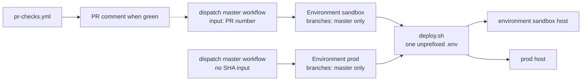

# CD discussion — two environments, one mutator

Status: closed 2026-10-19. The user ordered the spine with no overrides. The leans below are adopted. The spine is `ARCHITECTURE-SPINE.md` in this folder.

Audience: you, closing the environment and click calls. Story writers come after.

This does not redesign the running control plane. It says how the unbuilt click attaches to the deploy path that already exists.

## Correct these

Reply with "assumptions stand" or a numbered override. The leans are tagged **[ASSUMPTION]** in the body.

| # | Lean | Overturn if |
| --- | --- | --- |
| 1 | The click is Run workflow on the **master** copy of the workflow. A green check only adds a line to the existing PR comment. | You need a native button on the pull-request page. That forces a job that waits for approval. |
| 2 | Both GitHub Environments allow deployment only from `master`. That setting is in the repo, not in the workflow file. | You want a feature branch's own workflow file to be what runs. |
| 3 | No second approver. Dispatch is the click. | You want a required reviewer even though one person would approve their own run. |
| 4 | Both clicks run `make deploy`. Prod refuses first if the host has no Hermes venv. | Prod should be allowed to bootstrap an empty host, or should run a narrower command than sandbox. |
| 5 | No destroy command. | The product itself must wipe the environment sandbox. |

## Already settled

Not open. Taken from the tree and from the PRD memlog of 2026-10-18.

- This checkout deploys. It never becomes the agent. `scripts/deploy.sh` is the only mutator. Make calls it. It reads one file, `$ROOT/.env`, and requires `TARGET_HOST`, `TARGET_USER`, `OPENROUTER_API_KEY`, `TELEGRAM_BOT_TOKEN`, and `TELEGRAM_ALLOWED_USERS`.
- The script does not know the words prod or sandbox. It must stay that way. A second deployer, or `TARGET_HOST_PROD` inside the scripts, is how two stories diverge.
- The secret filter is `build_runtime_env`. Control-plane variables never reach the agent host. Pair gates, loopback binds, the session-path patch, and the idempotent remote scripts stay as they are.
- Full deploy does not wipe a host that already has Hermes. Bootstrap skips the installer when either `/usr/local/lib/hermes-agent/venv/bin/hermes` or `~/.hermes/hermes-agent/venv/bin/hermes` exists. It still rewrites the runtime env and config and restarts the gateway.
- Artifact sync has no `--delete`. A checkout without seeds does not erase remote seeds. Skill bodies and cron jobs are not in git, so a runner checkout cannot be their source. The click does not push them.
- Pull-request checks are lint and unit tests in `.github/workflows/pr-checks.yml`. They do not SSH and they hold no secrets. Deploy does not join that file.
- Two environments are separate agent hosts, with separate tokens, allowlists, runtime envs, and snapshot prefixes. Prod is an update, not a teardown. The environment sandbox may be destroyed between runs. This repo does not provision a VPS.
- Laptop deploy stays the exception for an atomic test, and for the first prod stand-up if assumption 4 holds. The CD runner does not read the laptop `.env`.
- The addendum conflict table still says CI deploy is a non-goal. The PRD memlog overturned that. This discussion follows the memlog. That row should be corrected when the addendum is next touched. It is not a reason to change the host.

## Shape

The dotted line is a pointer. The comment does not start a deploy.

The runner is a control plane. It is GitHub-hosted `ubuntu-latest`, the same family as pull-request checks. It is not the laptop and not an agent host. **[ASSUMPTION]**

## Fork 1 — what the click is

The PRD allows the click to be absent, or refused, until the gate is met. It also says a click appears on the pull request. GitHub does not offer a native button that is hidden until checks pass and that lives on the pull-request page, unless a job is already waiting.

Three ways to do it:

| | What the operator does | What starts before the click | Non-bypassable gate |
| --- | --- | --- | --- |
| Dispatch the master workflow | Run workflow. Sandbox fills in a PR number. Prod fills in nothing. | Nothing. Green checks do not queue a job. Merge does not queue a job. | Environment branch policy, in repo settings. |
| Dispatch the pull-request branch | Run workflow on that branch. | Nothing. | Weak. That branch's workflow file is what runs, so it can skip the check and still ask for secrets. |
| Queue, then approve | Review deployments, then Approve and deploy. | A waiting job, after checks succeed for sandbox, or after merge if prod were push-triggered. Up to 30 days. | Environment required reviewers. Secrets stay sealed until approval. |

**[ASSUMPTION] Dispatch the master workflow.** It is the only option that keeps "nothing runs until the click" and still stops a feature branch from rewriting the gate.

Why the other two lose:

- Dispatching the pull-request branch uses that branch's workflow file. Someone with write can delete the green-check and the prod refusal. The PRD's collaborator has write: they branch off master in this repo. Fork authors do not, and they are not given a click.
- A queued approval matches "a button appears" better, and GitHub does seal environment secrets until a required reviewer approves. I confirmed that against GitHub's deployment docs on 2026-10-18. The cost is a waiting job. `workflow_run` would also run the workflow file from master, which is good, and then check out the pull-request SHA and execute it with secrets, which is the dangerous shape if the "checks succeeded" condition is wrong. It does not put a check row on the pull request. The review screen is the Actions run. So it spends the queued job and still may not satisfy "on the pull request."

The "appears" signal under this lean is a line on the comment `pr-checks.yml` already posts: checks passed, sandbox click is the master workflow, this PR number. The testable consequence the PRD actually requires is refusal, not a widget. **[ASSUMPTION]**

No `pull_request` deploy. No `pull_request_target`. GitHub is blocking that event by default on public repos from 2 November 2026, and it is the wrong tool here anyway. **[ASSUMPTION]**

Sam can click because Sam has write. A stranger's fork cannot dispatch. That matches UJ-4, which has Sam branching off master, not forking. **[ASSUMPTION]**

## Fork 2 — where the gate lives

`workflow_dispatch` runs the workflow file of the ref you select. A check written only in that file is not a gate. Anyone with write can select a ref whose file deleted the check.

GitHub Environment deployment branch rules are matched against `GITHUB_REF` and are stored in repository settings. A branch cannot edit them. On a public repo they are available; this repo is public (`HassenIO/hermes-on-demand`). Environment secrets are not readable until those rules pass. Confirmed against GitHub docs on 2026-10-18.

**[ASSUMPTION] Both environments restrict deployment branches to `master`.** Not `main`.

Consequences:

- A feature-branch workflow that names `environment: prod` or `environment: sandbox` never receives secrets. The job is refused before it starts.
- The sandbox click still deploys a pull-request revision, because the trusted master workflow checks out that revision. The run's ref stays `master`, which is what the branch rule sees. The policy does not attest the SHA. The master workflow must.
- Prod never checks out a pull-request SHA. It checks out `master` only.
- One workflow with an `environment` input is rejected. A string input is not a policy. Two workflows, or two jobs with the environment name hardcoded. A sandbox run cannot start a prod job.
- The first pull request that adds these workflows cannot sandbox-deploy itself. The workflow file has to be on master before dispatch can use it. That PR is tested from the laptop, then merged. Later pull requests get the click.

Sandbox input is a pull-request number, not a host, not an environment name, not a raw SHA. The master workflow resolves the head SHA, requires a same-repo pull request, and requires the pull-request checks to have succeeded for that SHA. **[ASSUMPTION]**

A person with write can still run the prod workflow from the Actions tab once the ref is master. That is UJ-5. I did not confirm that a personal public repo can limit dispatch of one workflow to a single user. Do not depend on that. **[ASSUMPTION]** No required reviewer, and do not enable prevent-self-review. There is one operator. A required reviewer would be a second click by the same person, or a deadlock.

What the green check does not prove: lint and unit tests do not read secrets and do not prove `deploy.sh` will keep them. Deploying a revision means running that revision's deploy script with the sandbox secrets. A malicious green pull request can leak the sandbox set. That is accepted for a trashable host. It is not accepted for prod, which never runs a pull-request SHA.

## Fork 3 — how secrets reach the mutator

`deploy.sh` dies if `$ROOT/.env` is missing. It does not treat a pre-exported environment as a substitute. `load_dotenv` overwrites from the file.

**[ASSUMPTION] The job writes a mode-600 `.env` from that environment's secrets, then runs `make deploy`.** Secret names match the variable names, so there is no second mapping two stories could invent. The exception is the SSH private key: secret `SSH_PRIVATE_KEY`, written to a temp file, passed as `SSH_IDENTITY_FILE`. `SSH_*` is already stripped by the filter, so the key does not enter the runtime env.

Correction, 2026-10-21: GitHub forbids a secret name that starts with `GITHUB_`. The Environment secret is `AGENT_GITHUB_TOKEN`, written into the dotenv file as `GITHUB_TOKEN`. The laptop `.env` still uses `GITHUB_TOKEN`. The ambient runner token is always cleared. It is never the agent token.

The job never loads both secret sets. It never takes a host input. `ALLOW_LOCAL_TARGET` and `PIN_CRON_FORCE` are unset. Each environment has its own bot token and its own `S3_PREFIX`.

`scp_cmd` in `deploy.sh` does not set `BatchMode` or `StrictHostKeyChecking`. `ssh_cmd` does. A password or host-key prompt hangs a runner. **[ASSUMPTION]** That transport is fixed to the same non-interactive policy before the click is real. It does not need to happen on the agent host first. Known-host policy stays `accept-new`, which is already the deploy SSH policy. No pinned `known_hosts` unless you ask.

## Fork 4 — which command, and what prod refuses

`make update` is an upstream Hermes upgrade. It is not "deploy this revision." `--config-only` would not ship the script and extension changes the sandbox just ran. The thing tested has to be the thing promoted.

**[ASSUMPTION] Both clicks run `make deploy` and nothing else.** Full deploy is already an update on a host that has the venv: it does not reinstall Hermes, and it does not delete the host. It restarts the gateway. The PRD requires the gateway to be running afterward, not that it stay up for the whole run.

**[ASSUMPTION] The prod workflow, not `deploy.sh`, refuses if neither venv binary above exists.** Then it calls `make deploy`. Sandbox does not refuse. An empty sandbox host is a first deploy, which the PRD wants. An empty prod host is not an update. First prod stand-up stays the laptop exception.

This preflight does not stop prod secrets from pointing at the sandbox host. That host has a venv. The control against that is: no host input, and the two secret sets are never in one job. Pointing prod at the wrong host is an operator error in the GitHub Environment, same class as a bad laptop `.env`, and it is no longer a forgotten `TARGET_HOST` in a shared file.

The click does not call `skills-push`, `cron-push`, or seed push. Those trees are not in the checkout. **[ASSUMPTION]**

Correction, 2026-10-21: a fresh host still needs a non-empty `USER.md` or health fails. The sandbox Environment holds that text as `USER_MD`. The workflow writes `artifacts/USER.md` before `make deploy`. The existing artifact install path copies it. An empty secret refuses the sandbox click. Prod may omit it, and an omitted file does not erase the remote seed.

## Fork 5 — destroy

The PRD says the environment sandbox may be destroyed between runs, and that this product has no VPS provisioner. Destruction is permission, not a required command.

**[ASSUMPTION] No destroy target.** You wipe or replace the sandbox host outside this repo. The next sandbox click bootstraps whatever host the sandbox secrets point at. Prod has no destroy path.

## Concurrency and logs

**[ASSUMPTION]** One deploy at a time per environment. `cancel-in-progress: false`, so a second click waits instead of killing a half-applied sync. The two environments may run at the same time. They are different hosts.

Logs must not print secrets, tokens, or the runtime env. The existing SSH probe line, user and host, is not a secret. The materialised `.env` is not uploaded and not echoed. The runner is wiped after the job.

## Not this discussion

Parked in the PRD. None of them block the click.

- Whether the filter refuses an explicit allow-all.
- License and `CONTRIBUTING`.
- Author name strings.
- Proving the snapshot bucket is private.
- Localhost refusal on `ssh`, skill sync, and cron sync. The click does not call those targets. The laptop exception still has the gap.
- Whether `extensions/registry.yaml` is loaded.

## After you correct this

Accepted leans become constraints in the memlog. The spine then ratifies the existing mutator and adds only the CD invariants two stories could still get wrong: one mutator, one secret set per run, gates in repository settings, prod never checks out a pull-request SHA. It will not re-decide Open Questions 1–6.
